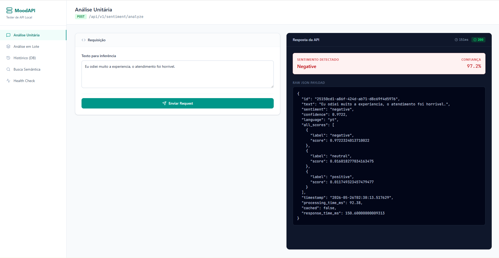
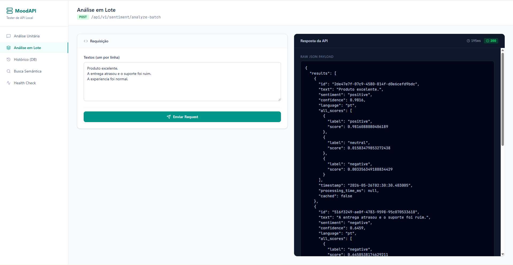
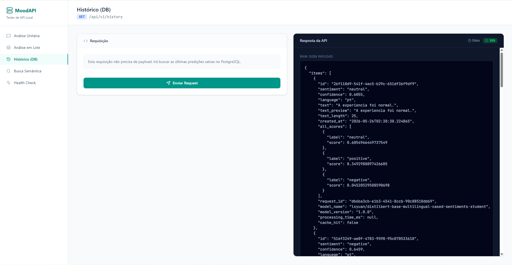
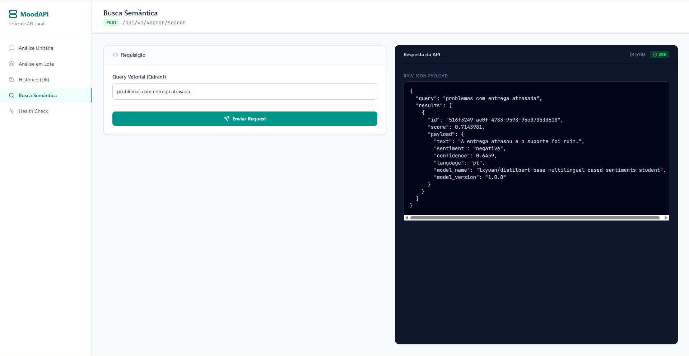
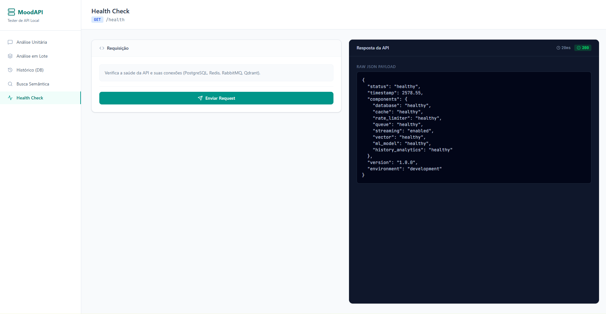

# MoodAPI


**Production-minded sentiment intelligence platform with Transformer inference, auditable prediction history, async processing, event streaming, semantic search and local observability.**

[](https://python.org)
[](https://fastapi.tiangolo.com)
[](https://react.dev)
[](https://postgresql.org)
[](https://redis.io)
[](https://rabbitmq.com)
[](https://qdrant.tech)
[](LICENSE)

---

## Documentation / Documentacao

**Repository:** [thiagodifaria/MoodAPI](https://github.com/thiagodifaria/MoodAPI)  
**Leia em Portugues:** [README_PT.md](README_PT.md)  
**Read the detailed English README:** [README_EN.md](README_EN.md)  
**Architecture:** [docs/ARQUITETURA.md](docs/ARQUITETURA.md)

---

## Visual Preview

### Single Analysis



### Batch Analysis



### Prediction History



### Semantic Search



### Health Check



---

## What is MoodAPI?

MoodAPI is a compact AI platform shaped like a real backend product. It receives text, runs multilingual sentiment inference, persists predictions for audit/history, indexes records for semantic search and exposes a React technical console for validating the API.

The project is intentionally organized as a portfolio-grade service: the root stays clean, backend code lives under `service-api/`, frontend code lives under `client-web/`, infrastructure lives under `infra/`, and database assets stay separated by technology.

---

## Highlights

- FastAPI backend with Pydantic v2 validation.
- React/Vite technical console for real endpoint testing.
- Hugging Face Transformer sentiment inference.
- PostgreSQL audit/history storage.
- Redis cache and rate limiting.
- RabbitMQ/Celery asynchronous jobs.
- Redpanda/Kafka-compatible event streaming.
- Qdrant semantic search with multilingual embeddings.
- Prometheus, Grafana and OpenTelemetry local observability.
- Bash scripts for build and test workflows.

---

## Quick Start

```bash
./scripts/build.sh up
```

Useful local URLs:

| Surface | URL |
|---------|-----|
| Client Web | `http://localhost:3000` |
| API | `http://localhost:8000` |
| Swagger | `http://localhost:8000/docs` |
| Metrics | `http://localhost:8000/metrics` |
| Prometheus | `http://localhost:9090` |
| Grafana | `http://localhost:3001` |
| RabbitMQ UI | `http://localhost:15672` |
| Qdrant | `http://localhost:6333` |

---

## Validation

```bash
./scripts/build.sh check
./scripts/test.sh all
```

The validation flow covers backend linting, typing, tests, frontend build and Docker Compose configuration.

---

## Contact

**Thiago DI Faria** - thiagodifaria@gmail.com

[](https://github.com/thiagodifaria)
[](https://linkedin.com/in/thiagodifaria)

---

## License

Licensed under the [MIT License](LICENSE).
